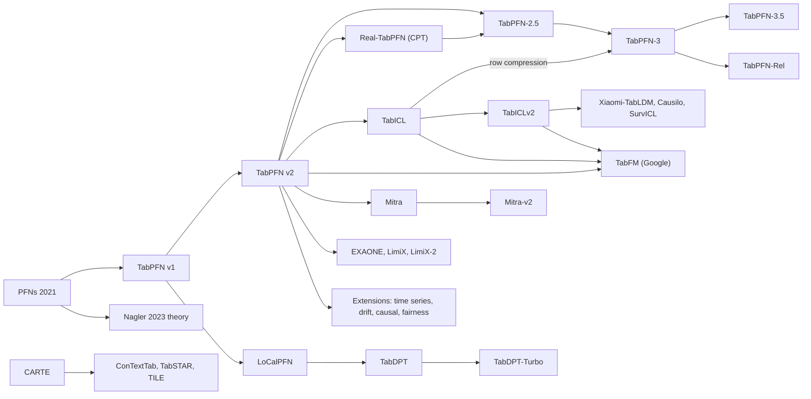

# The Tabular Foundation Model Paradigm — a literature synthesis

A **tabular foundation model (TFM)** is a network — almost always a transformer — pretrained once on very many tabular prediction tasks, usually synthetic, so that at deployment it solves a new task by in-context learning (ICL): the labelled training rows are the context, and predictions for query rows come out of a forward pass with no gradient updates and no hyperparameter search. The founding papers read this as amortised Bayesian inference; later work offers a retrieval-and-aggregation reading of the same behaviour. Either way, "fit a model" has become "condition a model", and the central research objects are the pretraining distribution (the *prior*), the architecture that consumes a table as context, and the way a pretrained model is adapted, extended and evaluated.

**How to use this document.** It is a single argument over the 70 papers in this library. Sections 1–3 orient (summary, timeline, lineage diagram). Sections 4–9 build the argument: theory, model lines, priors and data, adaptation, extensions, and evaluation. Sections 10–13 are for use: an evidence table, the explicit disagreements, a practitioner guide and open frontiers. Per-paper detail — venue, method, numbers, strengths and limitations — lives in [`SUMMARIES.md`](SUMMARIES.md); this document discusses papers only in relation to one another.

**Evidence conventions.** A result attributed to a paper is that paper's own measurement. **Developer-reported** marks results from a technical report by the lab that ships the model — unreviewed, usually against the lab's chosen comparators, and often from a configuration outside public reach. Sentences opening with *Reading:* are this synthesis's interpretation, not any paper's claim. Citations give `Author Year (Model)` or `Author Year (*Short title*)` on first mention within a section and a short form afterwards; links point to the paper's entry in `SUMMARIES.md`.

**Contents**

1. [TL;DR](#tldr)
2. [Timeline & lineage](#timeline--lineage)
3. [Lineage diagram](#lineage-diagram)
4. [Foundations and theory](#foundations-and-theory)
5. [Model lines and architecture](#model-lines-and-architecture)
6. [Priors and data](#priors-and-data)
7. [Adaptation](#adaptation)
8. [Extensions to new problems](#extensions-to-new-problems)
9. [Evaluation and reliability](#evaluation-and-reliability)
10. [Evidence table](#evidence-table)
11. [Where the papers disagree](#where-the-papers-disagree)
12. [Practitioner guide](#practitioner-guide)
13. [Open frontiers](#open-frontiers)

## TL;DR

- **One trick underlies the field.** Müller 2021 (*Transformers Can Do Bayesian Inference*) showed that training a transformer to predict held-out labels on datasets sampled from a prior makes its forward pass approximate the posterior predictive distribution (PPD). Every TFM here inherits that recipe, which makes the prior, not only the architecture, a first-class design object.
- **Three theories converge on locality.** Nagler 2023's bias–variance analysis (bias vanishes only under localisation), Zheng 2025's spectral analysis (bandwidth widens with context size) and Shaheen 2026's retrieval probes (TFMs learn to compare rows and pool labels) all say that with more context a TFM becomes more local. Cannistraci 2026's finding that half of every tested TFM's depth can be replaced by a linear map fits that picture. *Reading:* this is the strongest theoretical statement the corpus supports.
- **Synthetic priors won the frontier; real data helps narrowly.** TabPFN v2 beat tuned GBDTs on small tables using synthetic SCM data only. Real-data continued pretraining (Garg 2025, Real-TabPFN) helps, but purely synthetic successors (TabPFN-3, TabICLv2) beat real-data checkpoints on generic benchmarks. Controlled prior ablations (O'Prior) identify mechanism diversity as the main driver of transfer.
- **Architectures diverged after a brief convergence.** Column-embed → row-compress → ICL (TabICL, TabPFN-3, Google's TabFM) looked settled in mid-2026. Persistent-cell models (EXAONE, LimiX-2), delayed compression (Causilo), row-based long context (TabDPT-Turbo) and sparse MoE (Xiaomi-TabLDM) are now credible alternatives. No controlled comparison separates them.
- **The attribution problem is the field's methodological debt.** Most 2026 technical reports change prior, architecture, optimiser and context range at once, without ablation (O'Prior names the problem; Mitra-v2 concedes it of itself). Leaderboard gains therefore rarely identify the component responsible.
- **Adaptation is backbone-dependent.** Full fine-tuning was best for TabPFN v2 (Rubachev 2025), collapses some other architectures (Tanna 2026), and is approached by compact query–key scaling on newer backbones (Ning 2026). Frozen ICL is the baseline to beat; keep frozen and full-FT controls and compare total compute.
- **Context construction is a hidden hyperparameter.** How the context is sampled, retrieved or balanced can matter as much as which TFM is used (Tanna 2026's resampling study, with dataset-dependent gains), and attention-based retrieval can fail badly under matched controls (Ning 2026).
- **Calibration holds on average, not locally.** TabReliBench (Zhao 2026) finds near-nominal marginal coverage and strong proper scores out of the box, but poor and heterogeneous subgroup coverage that neither ensembling nor conformal methods reliably repair. Naive fine-tuning can damage calibration (Tanna 2026).
- **Generality is regime-bound, and the boundary is moving.** Beyond IID (Purucker 2026) showed TFMs losing to tuned RealMLP/CatBoost on temporal, grouped, large and high-cardinality data. TabPFN-3.5 reports first place on that benchmark after retuning its prior for those regimes, a developer-reported, unablated result.
- **The recipe extends by rewriting the prior.** Drift, causal effects, fairness, survival, Bayesian optimisation and time series are all handled by changing what the prior simulates or how the task is framed. Relational databases are handled either natively (KumoRFM-2) or by flattening into a TFM (TabPFN-Rel); those two routes have not shared a protocol.
- **Semantics is a separate axis that synthetic priors cannot supply.** String and text columns need external knowledge (CARTE, ConTextTab, TabSTAR, MulTaBench). TILE shows a frozen LLM with the right interface lifts every TFM tested on string tables.
- **The frontier is becoming less open.** Strongest checkpoints increasingly ship with restrictive weight licences, API-only variants and undisclosed priors. The open middle of the field — TabICLv2, TabDPT, Mitra-v2, nanoTabPFN and the independent benchmarks — carries most reproducible evidence.

## Timeline & lineage

The trunk runs from PFN theory (2021) through TabPFN v1 (2023) and v2 (2025) to TabPFN-2.5, -3 and -3.5 (2026). A second line starts with TabICL's row compression and becomes the most copied architecture. Around them sit the scaling and prior-design work, the adaptation studies, the extensions that re-target the PFN recipe, knowledge- and text-based transfer (CARTE and successors), relational models, and from 2026 a dense run of industrial technical reports and independent benchmarks.

| Date | Paper | What it added | Builds on |
|---|---|---|---|
| 2021-12 | Müller 2021 (PFNs) | Bayesian PPD inference recast as supervised ICL over prior-sampled datasets | Transformer ICL; amortised inference |
| 2023-05 | Müller 2023 (PFNs4BO) | PFNs as flexible GP-surrogate replacements for Bayesian optimisation | Müller 2021 |
| 2023-07 | Nagler 2023 (*Statistical Foundations of Prior-Data Fitted Networks*) | Frequentist reading: variance vanishes by averaging, bias only under localisation | Müller 2021 |
| 2023-09 | Hollmann 2023 (TabPFN v1) | First practical TFM: small-table classification from an SCM/BNN prior | Müller 2021 |
| 2024-03 | Rundel 2024 (*Interpretable ML for TabPFN*) | One-pass refits make LOCO, exact-retraining SHAP and Data Shapley cheap | TabPFN v1 |
| 2024-06 | van Breugel & van der Schaar 2024 (*Why Tabular Foundation Models Should Be a Research Priority*) | Position: "large tabular models" are underexplored and within academic reach | TabPFN v1; LLM-scaling analogy |
| 2024-07 | Kim 2024 (CARTE) | Graphlet and knowledge-graph pretraining transfers across unmatched schemas and entities | String embeddings; contrastive pretraining |
| 2024-10 | den Breejen 2024 (TabForestPFN) | Unrealistic forest prior fine-tunes better than a realistic one | TabPFN v1; prior design |
| 2024-11 | Helli 2024 (Drift-Resilient TabPFN) | Time-indexed second-order SCM prior for temporal shift | TabPFN v1 prior |
| 2024-12 | Hoo 2024 (TabPFN-TS) | Frozen TabPFN regressor plus calendar features for zero-shot forecasting | TabPFN v2 regressor |
| 2024-12 | Thomas 2024 (LoCalPFN) | Retrieved k-NN contexts plus fine-tuning; localisation in practice | TabPFN v1; Nagler 2023 |
| 2024-12 | Feuer 2024 (TuneTables) | Learned compressed contexts lift v1's row ceiling with few trained parameters | TabPFN v1; prompt tuning |
| 2025-01 | Hollmann 2025 (TabPFN v2) | Cell-level bi-attention, larger SCM prior, regression head; beats tuned GBDTs on small data | TabPFN v1 |
| 2025-02 | Liu & Ye 2025 (BETA) | Frozen TabPFN plus lightweight ensemble encoder and bagging | TabPFN v1; PEFT |
| 2025-02 | McCarter 2025 (*What exactly has TabPFN learned to do?*) | Behavioural probes of v1/v2 decision surfaces, duplication and parity | TabPFN v1/v2 |
| 2025-05 | Qu 2025 (TabICL) | Column-collapsing row embeddings before ICL; 500K rows | TabPFN v2; set encoders |
| 2025-05 | Müller 2025 (*The Future of Bayesian Prediction Is Prior-Fitted*) | Position: PFNs as the future of Bayesian prediction, with candid failure modes | Müller 2021 |
| 2025-06 | Ye 2025 (*A Closer Look at TabPFN v2*) | Mechanism of random feature tokens; test-time divide-and-conquer for v2's limits | TabPFN v2 |
| 2025-06 | Rubachev 2025 (*On Finetuning Tabular Foundation Models*) | Full FT matches PEFT for v2 by sharpening query–key retrieval; unstable under temporal shift | TabPFN v2 |
| 2025-06 | Robertson 2025 (FairPFN) | Biased/fair SCM pairs teach counterfactually fair prediction | SCM prior |
| 2025-07 | Garg 2025 (Real-TabPFN) | Continued pretraining of v2 on 71 curated real tables with L2-SP | TabPFN v2 |
| 2025-10 | Zhang 2025 (Mitra) | Principled mixing of SCM and tree priors; ships in AutoGluon | TabPFN v2; TabICL priors |
| 2025-10 | Wu 2025 (APT) | Adversarial generators adapt the prior during pretraining | TabPFN v1 prior |
| 2025-11 | Robertson 2025 (Do-PFN) | Observational context to interventional prediction without a causal graph | SCM prior |
| 2025-11 | Zhang 2025 (*TabPFN: One Model to Rule Them All?*) | Statistics-audience account of v2 as approximate Bayesian inference | TabPFN v2 |
| 2025-11 | Bouadi 2025 (Orion-MSP) | Multi-scale sparse attention and memory between the three ICL stages | TabICL design |
| 2025-11 | Zheng 2025 (*From Tables to Signals*) | Context kernel; spectral adaptivity widens with context size | Nagler 2023 |
| 2025-11 | Zhang 2025 (LimiX) | Masked context-conditional pretraining for prediction, imputation and generation | SCM priors |
| 2025-12 | Tanna 2025 (TabTune) | Unified zero-shot, meta, SFT and LoRA tooling across seven TFMs | TabPFN v2; TabICL |
| 2025-12 | Spinaci 2025 (ConTextTab) | Semantic per-modality embeddings in a table-native ICL model trained on real tables | TabPFN/TabICL; CARTE |
| 2025-12 | Arazi 2025 (TabSTAR) | Unfrozen, target-aware text encoder; scaling in number of datasets | LLM-tabular line |
| 2025-12 | Balazadeh 2025 (CausalPFN) | Amortised CATE/ATE estimation under ignorability | Do-PFN |
| 2025-12 | Pfefferle 2025 (nanoTabPFN) | Short educational reimplementation of v2's architecture | TabPFN v2 |
| 2025-12 | Arbel 2025 (EquiTabPFN) | Target-permutation equivariance; removes class-count ceiling | TabPFN v2 |
| 2026-01 | Ma 2026 (TabDPT) | Row-based ICL pretrained on real tables with SSL and retrieval; scaling laws | TabICL rows; Garg 2025 |
| 2026-01 | Hoo 2026 (*From Tables to Time*) | Covariate-aware zero-shot forecasting with frozen TabPFN v2 | Hoo 2024 |
| 2026-01 | Klein & Hoffart 2026 (*Foundation Models for Tabular Data within Systemic Contexts Need Grounding*) | Position: tables need grounding in code, rules and knowledge graphs | Critique of single-table ICL |
| 2026-02 | Grinsztajn 2026 (TabPFN-2.5) | v2 architecture scaled; Real-TabPFN-2.5 variant; distillation engine | TabPFN v2; Garg 2025 |
| 2026-02 | Ma 2026 (CausalFM) | One PFN per identification setting; identification settled before estimation | Do-PFN |
| 2026-03 | Kolberg 2026 (TabPFN-Wide) | Synthetic continued pretraining to 30k+ features | TabPFN v2; Garg 2025 recipe |
| 2026-04 | Tanna 2026 (*Exploring Fine-Tuning for Tabular Foundation Models*) | Fine-tuning benchmark: rarely helps, sometimes collapses accuracy and calibration | TabTune |
| 2026-04 | Bouadi 2026 (Orion-BiX) | Bi-axial encoder and label-aware hierarchical ICL head | Orion-MSP |
| 2026-04 | Hudovernik 2026 (KumoRFM-2) | Database-native relational FM over time-consistent subgraphs | Single-table ICL; relational learning |
| 2026-05 | Grinsztajn 2026 (TabPFN-3) | TabICL-style row compression, synthetic prior, 1M rows, thinking mode | TabPFN-2.5; TabICL |
| 2026-05 | Tanna 2026 (*Data Presentation Over Architecture*) | Context construction outweighs TFM choice on two imbalanced credit datasets | TabTune |
| 2026-05 | Hosseinzadeh 2026 (TabDPT-Turbo) | Retrieval dropped for long-context pretraining; row-based efficiency | TabDPT; LoCalPFN |
| 2026-05 | Schambach 2026 (*Benchmarking Attention for Tabular Foundation Models*) | Attention backend and memory layout as measured cost variables | TabPFN v2-style attention |
| 2026-06 | Purucker 2026 (*Beyond IID*) | Non-IID benchmark on which TFM ICL trails tuned baselines | TabArena; TabReD |
| 2026-07 | Luo 2026 (*Memory-Efficient Tabular Foundation Models*) | Post-hoc INT4 weight quantisation: smaller compressed checkpoints, unchanged inference memory | TabPFN v2.5/v2.6 |
| 2026-08 | Shaheen 2026 (*Understanding the Surprising Generalization Properties of TFMs*) | Single-table pretraining transfers; retrieval-and-aggregation account | Nagler 2023; TabDPT |
| 2026-08 | Eo 2026 (EXAONE Tabular 1.0) | Persistent cells with interleaved feature/item attention at every layer | TabPFN v2 vs row compression |
| 2026-08 | Klötergens 2026 (*Do Tabular Foundation Models Agree with Themselves?*) | Label-free marginalisation and factorisation consistency tests | Bayesian PPD reading |
| 2026-09 | Qu 2026 (TabICLv2) | Open model: new SCM prior, QASSMax, Muon; million-row scale | TabICL |
| 2026-09 | Jäger 2026 (TabPFN-3.5) | Prior retuned for non-IID regimes; Fourier encodings; first on seven suites | TabPFN-3; Beyond IID |
| 2026-09 | Tao 2026 (Mitra-v2) | Same backbone, everything else changed; non-attribution declared; Apache-2.0 | Mitra |
| 2026-09 | Xiaomi Team 2026 (Xiaomi-TabLDM) | First sparse MoE in a TFM; regression-first evaluation | TabICLv2 |
| 2026-09 | Zhang 2026 (LimiX-2) | Persistent cells with target prediction plus masked-feature reconstruction | LimiX |
| 2026-09 | Cho 2026 (Causilo) | Cell refinement across features and context before compression | TabICLv2 |
| 2026-09 | Arazi 2026 (MulTaBench) | Text/image-tabular benchmark selecting for joint signal and target-aware gains | TabSTAR; ConTextTab |
| 2026-09 | Wang 2026 (LimiX-2M) | Localised scalar embeddings and sample-first attention in a small TFM | LimiX |
| 2026-09 | Hayler 2026 (RelArena-α / TabPFN-Rel) | Reproducible relational benchmark; flattened TabPFN-3 tops tuned models | TabPFN-3; TabArena |
| 2026-09 | Kong 2026 (TabFM) | Google's 408.7M row-compression model: Fourier cell embeddings, deep ICL predictor; frozen-weight ensembling and LLM program search | TabICL; TabICLv2; TabPFN-3 |
| 2026-10 | Ning 2026 (*Test-Time Compute for Tabular Foundation Models*) | Compact query–key adaptation, selective aggregation and matched retrieval controls | Rubachev 2025; LoCalPFN |
| 2026-10 | Zhao 2026 (TabReliBench) | Reliability benchmark: marginal vs subgroup calibration and coverage | Beyond IID; PPD claim |
| 2026-10 | Cannistraci 2026 (*Tabular Foundation Models Are Effectively Shallow*) | Half the blocks of eight TFMs replaceable by a label-free affine map | Luo 2026; localisation account |
| 2026-10 | Alberge 2026 (SurvICL) | Survival ICL with censoring-aware context and latent event-time supervision | TabICLv2 |
| 2026-10 | Deprez 2026 (*Is TabPFN the Silver Bullet for Insurance Pricing?*) | Insurance frequency/severity limits of generic benchmark success | TabPFN v2.6/v3 |
| 2026-10 | Lefebvre 2026 (TILE) | Frozen-LLM string features through a redesigned interface lift every TFM tested | CARTE; TabSTAR; ConTextTab |
| 2026-10 | Baesens 2026 (*Tabular Foundation Models for Credit Risk Prediction: A Dedicated Review and Empirical Comparison*; v3, first released May as *Foundation Models for Credit Risk Prediction: A Game Changer?*) | Untuned TFMs on 14 PD and 7 LGD datasets: TabPFN-3 first on both tasks, gains largest at small samples and rare defaults, mean PD underpredicted | TabPFN-3; TabICLv2; TabPFN-2.5; Mitra |
| 2026-10 | Bouadi 2026 (O'Prior, v2; first released May) | Controlled prior ablation with architecture and compute fixed | Mitra; nanoTabPFN |

## Lineage diagram

The diagram shows the main inheritance routes only; extensions and benchmarks are grouped. Arrows mean "builds directly on".

## Foundations and theory

### The PFN objective

Müller 2021 ([*Transformers Can Do Bayesian Inference*](SUMMARIES.md#pfns-2021)) recasts posterior-predictive inference, p(y | x, D) = ∫ p(y | x, t) p(t | D) dt, as supervised learning over datasets. One samples a task t from a prior, samples a dataset and a held-out point from it, and trains a transformer to predict the held-out label given the dataset as context. The method needs only the ability to *sample* from the prior, not to evaluate densities, which is what frees it from MCMC and variational inference. The paper shows that the cross-entropy on held-out labels equals, up to a constant, the expected KL divergence between the model's output and the true PPD.

Two consequences shape everything that follows. First, with fresh synthetic data at every step, lower training loss means a closer PPD approximation, so more pretraining is better and overfitting is not the usual concern. That guarantee disappears once training data become a finite real corpus, the regime real-data continued pretraining later enters. Second, the model can only be as good as its prior is realistic. The prior-design, real-data and domain-adaptation literatures are all responses to that limit.

Most of the original design survives. A transformer without positional encodings is permutation-equivariant over rows. Training rows attend to each other while test rows attend only to training rows, so test predictions are conditionally independent. A bucketed "Riemann" output distribution handles regression and is the ancestor of the bar-distribution heads in TabPFN v2 and its successors. On 21 small OpenML binary tasks, the 2021 PFN reported the best mean ROC-AUC rank against tuned XGBoost and CatBoost and an ECE of 0.025 against XGBoost's 0.066 — at proof-of-concept scale (about 100 rows, at most 60 features, balanced binary targets). Calibration falls out of the objective rather than being added afterwards; later measurement qualifies how far that holds (see [Evaluation and reliability](#evaluation-and-reliability)).

Müller 2025 (*The Future of Bayesian Prediction Is Prior-Fitted*) argues that PFNs are the future of Bayesian prediction while naming failure modes: nobody can state ex ante which datasets a prior covers; the original architecture cannot count duplicated evidence, a departure from Bayesian updating; and as n grows the prior's influence shrinks so tree-like inductive biases may win. Zhang 2025 (*TabPFN: One Model to Rule Them All?*) gives a statistics-audience account of TabPFN v2 as approximate Bayesian inference and reports strong out-of-the-box results in semi-supervised estimation, heterogeneous treatment effects and covariate shift, together with v2's limits (an MSE plateau around 10k rows, about 500 features, at most 10 native classes).

### Three accounts that converge on locality

Nagler 2023 ([*Statistical Foundations of Prior-Data Fitted Networks*](SUMMARIES.md#nagler-theory)) reads a PFN as a pre-tuned but untrained predictor — a fixed function of the context — and decomposes its error. **Variance** vanishes when sensitivity to any single context row vanishes, which attention averaging supplies. **Bias** vanishes only if the predictor is *localised* around the test point, and nothing in the architecture guarantees that. This also explains why PFN accuracy keeps improving on datasets larger than those seen in pretraining.

Zheng 2025 ([*From Tables to Signals*](SUMMARIES.md#spectral-adaptivity)) supplies a second instrument. Because an in-context learner has no parameter updates, the neural tangent kernel is meaningless; the authors define a **context kernel**, the Jacobian of query predictions with respect to context labels (for one attention block, the attention matrix). Through it TabPFN shows **spectral adaptivity**: its effective bandwidth widens with the number of context rows, while a ReLU MLP's widens only with training. Attention maps become sharper and more local as context grows. Positional encoding acts as a frequency dial, which explains why Hoo 2026 (*From Tables to Time*) needed it for time series. TabPFN also performs training-free image denoising competitive with implicit neural representations. The analysis is a local linearisation and is measured on the v2 line only.

Shaheen 2026 ([*Understanding the Surprising Generalization Properties of Tabular Foundation Models*](SUMMARIES.md#shaheen-retrieval)), written by the TabDPT group with TabPFN's senior author, reports that a transformer pretrained by self-supervision on a **single real table** transfers in context to unrelated tasks, roughly matching a random forest across 107 held-out CC-18 and CTR-23 datasets. Since a prior induced by one table cannot cover those tasks, the authors argue that a TFM learns a **retrieval-and-aggregation procedure**: pretraining teaches how to compare rows and pool labels, not what the world looks like. A "retrieve and copy" probe tracks model quality, and tying query and key projections makes attention an explicit negative squared distance. Because pretraining manufactures tasks by choosing target and feature subsets, **feature count** predicts transfer (R² = 0.67 from simple properties) while row count contributes little; column-level cleaning helps, whereas exact deduplication is unnecessary and restricting the corpus to tables with at least 30 features hurts. The study pretrains on real data with row-based attention only, so it does not directly test synthetic-prior or cell-based models.

*Reading:* these are one phenomenon seen three ways. Nagler said localisation is needed; Zheng measures it as context-dependent bandwidth; Shaheen observes it as learned retrieval. The retrieval-based models that later produced large gains over base TabPFN — Thomas 2024 (LoCalPFN) and Ma 2026 (TabDPT) — are localisation fixes found by experiment. Cannistraci 2026 ([*Tabular Foundation Models Are Effectively Shallow*](SUMMARIES.md#effectively-shallow)) adds a fourth, indirect line: a label-free affine map can replace half of the blocks in each of eight TFMs with at most 0.002 median AUROC loss, and half-depth compression is also near-lossless on 41 regression datasets. A localised retrieve-and-pool procedure has little use for deep nonlinear composition. This convergence is the strongest theoretical statement the corpus supports. It is not a proof: none of the four accounts tests all architecture families, and Cannistraci's single-block compression degrades most regressors.

### What a finite model actually does

The PFN argument is asymptotic; behavioural probes test trained models. McCarter 2025 ([*What exactly has TabPFN learned to do?*](SUMMARIES.md#mccarter-tabpfn)) shows that v1 ignores uniform duplication of its context yet becomes more confident when features are duplicated, and that ensembling makes toy multiclass regions resemble nearest-neighbour partitions. Its v2 appendix changes the diagnosis: fingerprinting distinguishes repeated rows, simple surfaces become bumpier, and ensembled v2 learns 10-bit parity from 127 examples at over 99% accuracy. Klötergens 2026 ([*Do Tabular Foundation Models Agree with Themselves?*](SUMMARIES.md#do-tabular-foundation)) tests whether a model's conditionals cohere as one joint distribution, using label-free marginalisation and factorisation identities. Every evaluated model/dataset shows violations. That qualifies generation or imputation built by chaining univariate conditionals; it does not refute predictive usefulness or equate consistency with calibration, and LimiX-style masked joint models were not among those tested.

*Reading:* neither the Bayesian motivation nor a spectral or retrieval analogy guarantees sensible behaviour on every context. The probes identify tests a theory must pass; they do not reveal the learned algorithm.

### The field's stated agenda

Three position papers frame what the field says it is doing, and the gap between them and what it built is instructive. van Breugel & van der Schaar 2024 (*Why Tabular Foundation Models Should Be a Research Priority*) argued that tabular data dominates science and industry yet was nearly absent from foundation-model research, while frontier results remained within academic compute. Their lasting contribution is a specification — mixed-type columns, cross-dataset modelling over heterogeneous schemas, use of textual metadata, column-order invariance — plus an argument that LLMs are a poor substrate for tables (tokenisation breaks numeric continuity, autoregressive decoding is slow and context-bound, sampling is poorly calibrated). They also flagged that web corpora omit exactly the proprietary, sensitive tables where impact would be largest, the gap real-data continued pretraining later targets. Their central bet, a *conditional generative* large tabular model, is not how the field went: the winning line is discriminative ICL over synthetic priors. LimiX and LimiX-2 move part of that agenda into the training objective through masked-feature reconstruction, which broadens conditional inference without solving arbitrary table generation.

Müller 2025 supplies the theoretical self-justification for the winning line, and endorses post-hoc fine-tuning "in domains where a lot of related datasets are available" — the closest the corpus comes to a first-principles rationale for continued pretraining. Its admission that the prior's influence shrinks as n grows reframes the scaling race as engineering whose *statistical* payoff is not guaranteed.

Klein & Hoffart 2026 (*Foundation Models for Tabular Data within Systemic Contexts Need Grounding*) argue against the isolated-table scope. Enterprise tables are generated by code, policies and workflows; a statistical prior can only blur a hard rule such as an approval threshold into a fuzzy correlation. Their proposed class of models generalises the PFN idea to synthetic pretraining on rule-to-row pairs plus retrieval of operational artefacts at inference. The paper has no experiments, defines an evaluation it never builds and reflects one vendor's view of what tables look like; it is a research programme, not evidence. The 2026 relational models address only its multi-table layer.

*Reading:* the empirical record has validated part of these agendas (PFN scaling, real-data continued pretraining, column invariance, text metadata) and largely ignored the rest (generative models, systemic grounding).

### Symmetry as a design lever

The architecture has gained one symmetry at a time. Müller 2021 dropped positional encodings for **row** order. TabPFN v2's random per-feature embeddings and TabICL's column encoder addressed **column** order; Ye 2025 (*A Closer Look at TabPFN v2*) shows the random tokens act like in-context feature identifiers. Arbel 2025 ([EquiTabPFN](SUMMARIES.md#equitabpfn)) identifies the missed one: **target** order. Permuting class labels changes TabPFN's predictions, and the residual "equivariance gap" shrinks only slowly during training. Equivariant encoders, decoders and target-axis attention close it. This explains an existing workaround — the label-permutation ensembling every TabPFN generation performs approximates the missing symmetrisation — and removes the class-count ceiling by construction: on TabZilla tasks with more classes than seen in pretraining, EquiTabPFN has the best median relative accuracy while v2 falls below linear models and random forests. Its baseline design is worth copying: because v2's prior is closed, the authors retrain v2's architecture on a public prior to isolate architecture. The limit is real: in 5 of 86 surveyed datasets the target is **ordinal**, where equivariance is the wrong assumption. TabICL's RoPE breaks column invariance and is patched by ensembling in turn (Ye 2025). *Reading:* which invariances hold is a property of the domain, and therefore of the prior.

## Model lines and architecture

### The TabPFN line

**v1** (Hollmann 2023, TabPFN) established the recipe at small scale: classification with at most 1,000 training rows, 100 numerical features and 10 classes, one token per row, a ~25.8M-parameter transformer, and a prior mixing SCMs and BNNs with a bias toward simple graphs. Test rows attend only to training rows, a masking discipline every successor keeps. Inference-time ensembling over feature rotations and label permutations compensated for imperfect invariances. Weaknesses were quadratic row attention, weak handling of categoricals and missing values, and no regression.

**v2** (Hollmann 2025, [TabPFN v2](SUMMARIES.md#tabpfn-v2-nature)) made each **cell** a token and alternated attention across features and across samples, giving row and column permutation invariance, native missing-value handling and variable feature counts. Regression arrived through a bar-distribution head over about 5,000 bins, able to represent bimodal and bounded predictive distributions. The prior grew to more than 100M synthetic SCM datasets (the paper states around 130M per model) and stayed purely synthetic. v2 beat tuned GBDTs on datasets up to 10k rows in one forward pass. Its limits — roughly 10k rows, 500 features, 10 classes, slower per-prediction inference than tuned GBDTs — were confirmed adversarially by Ye 2025, who also showed they can be partly patched without retraining (feature bagging, class decomposition, divide-and-conquer). Ye also found post-hoc permutation ensembling adds only about 0.3% for v2.

**TabPFN-2.5** (Grinsztajn 2026, [TabPFN-2.5](SUMMARIES.md#tabpfn-25)) kept the alternating attention and scaled it to 50k rows and 2k features, with deeper stacks, grouped feature embeddings, 64 learned "thinking rows" and an undisclosed improved prior. It ships a synthetic checkpoint and **Real-TabPFN-2.5**, continued-pretrained on 43 real datasets following Garg 2025. The real-data variant tops TabArena classification (developer-reported). Headline results are uncalibrated and no ECE or Brier scores are given. A distillation engine converts the model into MLPs or trees for deployment.

**TabPFN-3** (Grinsztajn 2026, [TabPFN-3](SUMMARIES.md#tabpfn-3)) is an architectural break toward TabICL: inducing-point column embeddings, CLS tokens compressing each row to a 512-d vector, and a row-level ICL transformer with multi-query attention. It reaches 1M training rows at 200 features (or 100k rows at 2,000 features) on one H100. Classification uses a retrieval-style decoder that handles up to 160 classes; regression keeps the bar head. The prior remains purely synthetic, extended with temporal, spatial, many-class and out-of-distribution components over more than 8T tokens, and beats Real-TabPFN-2.5 on TabArena (developer-reported). The API-only Thinking variant spends extra test-time compute and beats non-TabPFN models by over 200 Elo. v3 shares little with v2.x, so methods built on v2 (including continued-pretraining recipes) need revalidation rather than assumed transfer. Weights are released under a licence for research and internal evaluation.

**TabPFN-3.5** (Jäger 2026, [TabPFN-3.5](SUMMARIES.md#tabpfn-3-5)) answers Purucker 2026 (*Beyond IID*), which Prior Labs co-authored. Its prior is retuned for high-cardinality, wide and grouped data; per-cell encodings gain Fourier features; width doubles at constant KV cache; classification and regression share one checkpoint. It reports first place on all seven benchmarks it runs, including BeyondArena at an 83% win rate against TabICLv2 (developer-reported). Two things limit the result. The four changes ship together without ablation, so the BeyondArena gain cannot be attributed to the prior. And the reported numbers take the best family member per benchmark, including the API-only **-Plus** and **-Thinking** variants, while the downloadable weights carry a licence excluding commercial and production use.

Pfefferle 2025 (nanoTabPFN) reduces v2's architecture to an educational implementation trainable in about a minute on one GPU, using TabICL's prior. Its comparison against TabPFN is not like-for-like, but it is now the field's controlled-experiment sandbox (O'Prior and Cannistraci both use it).

### The TabICL line and the compression question

Qu 2025 ([TabICL](SUMMARIES.md#tabicl-2025)) observed that v2 pays a quadratic price on both axes and instead compresses each row into a fixed embedding with a column-wise set transformer before ICL over rows, reaching 500K rows on about 20 GB of GPU memory at roughly 10× v2's speed. The cost is that exact cell-level interaction is lost before the ICL stage. Qu 2026 ([TabICLv2](SUMMARIES.md#tabiclv2)) repairs the known pathologies: repeated circular feature grouping restores feature asymmetry; target-aware embeddings make the column stage itself in-context; QASSMax counters attention fading at long context. Pretrained for about 24.5 H100 GPU-days on a new SCM prior with Muon, it beats Real-TabPFN-2.5 untuned, is fully open, and scales to a million rows. Its ablations make the prior the largest single effect, and the new architecture diverges on the old TabICL prior. *Reading:* architecture and prior co-adapt and cannot be chosen independently.

Kong 2026 ([*TabFM: A Zero-Shot Foundation Model for Tabular Data*](SUMMARIES.md#tabfm)) documents Google's version of the same stack, released in June and described in a September paper: dyadic feature grouping with learned Fourier cell embeddings, two stages of induced column attention and RoPE row attention, CLS pooling, and a 24-layer ICL predictor that holds almost all of its 408.7M parameters, pretrained on synthetic SCM tables of up to 16,384 rows and 100 columns. It credits feature grouping to TabPFN-3 and TabICLv2 and its prior to TabICLv2, so with TabPFN-3 three labs reached this stack within months, partly by explicit borrowing. Zero-shot, it leads its TabArena pool on both tracks, but that pool omits TabPFN-3.5, LimiX-2 and Causilo, and the paper ablates nothing. Third-party reports (EXAONE, Mitra-v2, Ning, TabReliBench, *Effectively Shallow*) evaluated the June 1.64B checkpoint, not the paper's 1.1.0 checkpoint, so their size and latency ratios do not transfer. *Reading:* adoption by three labs is good evidence that this stack is a strong scaling answer, though weaker than independent rediscovery would be, since later entrants borrow components by name; it is not evidence that it is the only one (see the next subsection).

The TabICL design has become a base for others. Xiaomi Team 2026 ([Xiaomi-TabLDM](SUMMARIES.md#xiaomi-tabldm)) adds the first **sparse Mixture-of-Experts** in a TFM, replacing feed-forward sub-layers in selected ICL layers so heterogeneous datasets can route to specialised experts, plus dual-stream feature grouping. It evaluates regression first: first on OpenML-CTR23 (33 datasets) and second on TabArena regression with 82% less training and 68% less prediction time than TabFM (developer-reported). With four simultaneous changes and no limitations section, the MoE's own contribution is unmeasured. Cho 2026 ([Causilo](SUMMARIES.md#causilo)) delays compression: column encoding, row refinement and a second column pass precede compression, with summary tokens keeping feature-side attention linear. Its TabArena operating point (1785.4 Elo at 0.1043 s per 1K queries) trades some accuracy for latency relative to TabPFN-3.5 and LimiX-2. Bouadi 2025 (Orion-MSP) and Bouadi 2026 (Orion-BiX) add multi-scale sparse attention, Perceiver-style memory, bi-axial attention and a hierarchical label-aware head to the three-stage design; their main evidence comes from the same group's TabTune harness. Alberge 2026 (SurvICL) carries TabICLv2 into survival analysis (see [Extensions](#extensions-to-new-problems)).

### Persistent cells, row-based models and capacity choices

The compression consensus has been challenged from three directions.

**Persistent cells.** Eo 2026 ([EXAONE Tabular 1.0](SUMMARIES.md#exaone-tabular-1)) interleaves feature-axis and item-axis attention at every layer, linked by summary tokens, so cell-level state survives the full depth. A 20.8M-parameter classifier ranks first on TabArena from one default configuration, about 125 Elo ahead of TabPFN-3, and the regressor reaches the regime of the 1.64B-parameter TabFM at roughly 1/11 of its inference cost; it also leads ScoringBench on R², RMSE and CRPS (developer-reported). There is no ablation isolating the architecture from the prior and recipe, and baselines are quoted from leaderboards. Zhang 2026 ([LimiX-2](SUMMARIES.md#limix-2)) keeps persistent cells and trains both target prediction and masked-feature reconstruction, so retained cells support conditional prediction across variables; its 12.5M–406.2M capacity sweep is controlled scaling evidence under one recipe. The earlier Zhang 2025 ([LimiX](SUMMARIES.md#limix-unleashing-structured)) introduced the masked context-conditional objective for prediction, imputation and generation, and Wang 2026 ([LimiX-2M](SUMMARIES.md#limix-2m-mitigating)) shows that localised radial-basis scalar embeddings and sample-first attention improve a 2M-parameter model's accuracy/efficiency trade-off. *Reading:* the compression boundary is not necessary for frontier accuracy, but whether that is due to persistent cells or to good priors is unattributable.

**Row-based long context.** Ma 2026 ([TabDPT](SUMMARIES.md#tabdpt)) uses one token per row, real-data pretraining and retrieval (see [Priors and data](#priors-and-data)). Hosseinzadeh 2026 ([TabDPT-Turbo](SUMMARIES.md#tabdpt-turbo)), from the same lab, removes retrieval after measuring retrieval-style inference at least 100× slower than full-context inference, and replaces it with long-context pretraining while staying row-based. It reports about 2.4× and 13× lower total fit-plus-predict time than TabPFN-3 and TabICLv2 on TabArena-Lite. *Reading:* localisation can be acquired from the training distribution instead of engineered into the inference path.

**Capacity without size.** Tao 2026 ([Mitra-v2](SUMMARIES.md#mitra-v2)) keeps Mitra's 12-layer Tab2D backbone (75.7M parameters for classification) while widening support rows from 512 to 5,120 and features from 16 to 50, adding a Hybrid SCM that places different mechanisms at nodes of one graph, and changing optimiser and recipe. It reaches TabArena Elo 1,775 against TabFM's 1,774 and first place on TALENT's >10-class tasks through hierarchical decomposition. Its limitations section says the leading group is a statistical tie, the headline system uses fine-tuning and bagging so is not zero-shot, and context, features, prior, optimiser and recipe all changed at once. *Reading:* small models (EXAONE, Mitra-v2) matching a 1.64B model suggests priors and recipes do more than parameter count, but no study isolates this.

### Efficiency: kernels, weights and depth

Three papers treat cost directly. Schambach 2026 ([*Benchmarking Attention for Tabular Foundation Models*](SUMMARIES.md#attention-benchmark)) holds attention semantics fixed and shows that on its H100 setup feature-axis attention often favours cuDNN SDPA while sample-axis attention mostly favours FlashAttention-3, whose stride convention avoids tensor copies; layout alone yields up to 3.5× wrapper speedups. Architecture comparisons should therefore report kernels, layouts and hardware. Luo 2026 ([*Memory-Efficient Tabular Foundation Models*](SUMMARIES.md#memory-efficient-tfms)) applies post-hoc INT4 weight quantisation to TabPFN v2.5/v2.6: BZIP2-compressed checkpoint files shrink up to 7.6× (about 87% less storage) with at most 0.005 accuracy loss, while inference memory, dominated by activations, stays essentially unchanged (about 4.7 GB). It addresses distribution, not serving, and is an open counterpart to proprietary distillation. Cannistraci 2026 (*Effectively Shallow*) shows a one-block compressed TabPFN-3 serves cached queries 2.4× faster in 6× less memory, and that a natively shallow nanoTabPFN matches a deeper one; its headline is a ranking metric (AUROC), so calibration effects are not measured.

### Relational models

Hudovernik 2026 ([KumoRFM-2](SUMMARIES.md#kumorfm-2-scaling)) carries ICL from single tables to databases. Each context example is a time-consistent subgraph; task-conditioned attention within tables precedes foreign-key and cross-sample attention, and context labels are generated by replaying earlier database states. A constructed co-occurrence task shows any column-wise aggregation encoder scoring AUROC 0.5 where a row-aware model solves it. It reports 79.60 mean AUROC on RelBench v1 classification against RelGNN's 78.06 (developer-reported; model and weights closed). Hayler 2026 ([RelArena-α / TabPFN-Rel](SUMMARIES.md#advancing-open-and)) packages the opposite bet: flatten the database by deep feature synthesis and give the wide table to TabPFN-3. Under its unified harness (one data state, framework-tuned search spaces, 21 RelBench v1 entity tasks), TabPFN-Rel tops the tuned-model board, while a pretrained, per-task fine-tuned relational transformer (RT-PluRel) leads overall. Both routes still address only the multi-table layer of Klein & Hoffart 2026's grounding critique; the evaluation dispute between them is taken up in [Evaluation and reliability](#evaluation-and-reliability).

## Priors and data

### Synthetic priors as a design object

Before 2025, prior design was folklore: mix in tree generators for diversity. den Breejen 2024 (TabForestPFN) found that a deliberately **unrealistic** forest prior, chosen for decision-boundary complexity, fine-tunes better than a realistic one despite worse zero-shot accuracy — so realism and adaptability are different axes. Zhang 2025 ([Mitra](SUMMARIES.md#mitra)) replaced folklore with selection criteria: pretrain one model per candidate prior, measure cross-prior transfer and real-data performance, and admit priors that are performant, hard to overfit and not already covered. The resulting SCM/tree mixture edges out TabPFN v2 on ≤10k-row benchmarks, but Mitra pretrains on at most 16 features and 640 rows, loses to v2 on wide regression, and concedes that much of its fine-tuning gain compensates for this pretrain/downstream gap. Selection on one benchmark family risks meta-overfitting.

Bouadi 2026 ([O'Prior](SUMMARIES.md#oprior)) supplies the first controlled study: architecture, optimiser, compute and evaluation fixed, only the synthetic task distribution varied, using nanoTabPFN with 40,000 datasets per condition. The same architecture reaches 0.576 TabArena ROC-AUC under the TabPFN v1 prior and improves monotonically as priors improve. **Structural mechanism diversity** is the strongest driver of transfer, with observational realism (marginal morphing, missingness mechanisms, target reshaping) and shift-aware stress adding complementary gains. The study is classification-only and small-scale. Wu 2025 ([APT](SUMMARIES.md#apt)) makes the prior **adaptive**: 12.5% of generators shift toward what the model currently handles badly, producing more diverse data — the same diversity O'Prior identifies, manufactured dynamically. On 35 small OpenML-CC18 datasets, without the filters TabPFN v1's headline used, it ranks 3.86 against tuned CatBoost's 4.03 at a fraction of the time, though it compares only with v1 and reports no calibration.

The frontier priors moved the same way. TabICLv2's new SCM family (non-tree DAGs, eight function types, filtering of datasets an ExtraTrees model cannot beat) is its largest ablated gain. TabPFN-3 adds temporal, spatial, many-class and OOD components; TabPFN-3.5 retunes for high-cardinality, wide and grouped data; Mitra-v2's Hybrid SCM puts heterogeneous mechanisms within one task. Only O'Prior and TabICLv2 isolate the prior's contribution; the others change it alongside everything else.

### Real data: continued pretraining, real-only pretraining and the asymmetry

Garg 2025 ([Real-TabPFN](SUMMARIES.md#real-tabpfn)) continues pretraining TabPFN v2 on 71 curated large real tables with a very low learning rate (3e-7) and an L2-SP penalty (λ = 0.003) toward the base checkpoint. CPT context size is the active ingredient: gains rise from 2,048 to 20,000 rows, curated large tables add 0.022 normalised ROC-AUC while a corpus of tiny CommonCrawl tables slightly hurts, and calibration improves alongside discrimination. It is classification-only, absolute gains are small (0.929 → 0.932 raw ROC-AUC) and no hyperparameter sensitivity is reported. Real-TabPFN-2.5 later applies the recipe at scale.

Ma 2026 (TabDPT) pretrains on real data alone: 123 OpenML tables, tasks manufactured by masking columns as pseudo-targets, and contexts built from retrieved neighbourhoods to match inference. It reports Chinchilla-style power-law scaling and small wins over v2 at equal compute, with hard caps (100 features via PCA, 10 classes) and no calibration reporting. TabDPT-Turbo scales the corpus to 1,445 real tables. Shaheen 2026's single-table result argues the relevant quantity is the number of *tasks* a corpus yields, which width buys cheaply.

Against this stand the synthetic successors. TabICLv2 beats Real-TabPFN-2.5 with zero real data; TabPFN-3's purely synthetic prior also beats it on TabArena, although 2.5 remains stronger in the many-features/low-n regime. TabFM's June announcement justified synthetic-only pretraining on availability grounds (industrial tables are proprietary), while Kong 2026 lists combining synthetic priors with real tabular corpora as future work. Hoo 2026 adds the sharpest asymmetry: swapping TabPFN v2 for the real-data-pretrained TabDPT backbone substantially degrades zero-shot forecasting transfer, while Chronos, pretrained on real time series, still wins on datasets overlapping its own corpus.

*Reading:* the evidence favours "real data helps in-domain, synthetic breadth wins out-of-domain". Continued pretraining's value proposition is domain specialisation rather than generic uplift, and a sufficiently good synthetic prior may erase much of the generic headroom. The missing experiment — synthetic-prior improvement versus real-data CPT under a shared base and budget — is blocked mainly by closed frontier priors.

### Methodological practices worth copying

The prior literature also supplies reusable experimental controls. EquiTabPFN retrains v2's architecture on a public prior so that architecture is not confounded with a closed one. O'Prior fixes architecture, optimiser and compute and varies only the task distribution. Kolberg 2026 reports a forgetting check against the base model on original-range tasks. Garg 2025 ablates CPT context size and corpus type rather than reporting one configuration. TabDPT documents ideas that failed (cell tokenisation, NaN tokens, feature-name embeddings), which saves others from repeating them. Mitra's generalisability matrix measures cross-prior transfer before mixing. Mitra-v2 states its own non-attribution and statistical ties. *Reading:* a downstream study that changes a prior or continues pretraining should adopt at least the fixed-architecture control, a forgetting check and an overlap audit; most frontier reports adopt none.

### Semantics: the signal no synthetic prior contains

Sampled SCM columns have no names or meanings, so text-bearing tables need another source of knowledge. Kim 2024 ([CARTE](SUMMARIES.md#carte-pretraining-and)) pretrains on knowledge-graph graphlets with string embeddings, enabling transfer across unmatched columns and entities; its gains combine external knowledge, representation and supervised adaptation. Spinaci 2025 (ConTextTab) keeps a table-native ICL model but adds per-modality embeddings and real-table training, setting a new standard on the CARTE benchmark. Arazi 2025 (TabSTAR) unfreezes a text encoder and conditions it on target tokens; its pretraining shows scaling in the *number of datasets*. Arazi 2026 ([MulTaBench](SUMMARIES.md#multabench-benchmarking-multimodal)) selects 40 text/image-tabular datasets where both modalities add signal and target-tuned embeddings beat frozen ones; it is a deliberate stress test, not an unbiased ranking.

Lefebvre 2026 ([TILE](SUMMARIES.md#tile-bridging-llms)) takes the opposite route to TabSTAR and ConTextTab: leave the TFM unchanged and redesign how a **frozen** decoder LLM supplies string features — whole-row serialisation, a middle layer, per-column pooling and PCA, and direct by-passes for numerical and categorical columns. On 100 string tables it leads the strongest of 30 baselines by +333 Elo, lifts every TFM tested, and takes the top four places on the separately assembled STRABLE benchmark (108 tables, 51 baselines; partial overlap of sources with the main benchmark). Two side results generalise. Applied cell by cell, a larger LLM does not give better features; with row context, it does. Plain TF-IDF fed to a current TFM roughly matches the cell-wise 8B LLM and beats the end-to-end text-aware models. *Reading:* claims that LLM knowledge does or does not help tables are claims about an interface as much as a model. Possible LLM memorisation of benchmark entities is not audited, and TILE was not compared with MulTaBench's target-aware encoders.

## Adaptation

Given a pretrained TFM, one can change the prior (corpus-level continued pretraining), the weights for one task (fine-tuning), a small set of parameters, the inference procedure, or the context. The corpus answers these questions on different architectures under different budgets, which is why results seem to conflict.

### Continued pretraining

Garg 2025 (Real-TabPFN) defines the corpus-level route: two-stage training (synthetic base, then real tables), a very low learning rate, L2-SP regularisation and one dataset per step. Kolberg 2026 ([TabPFN-Wide](SUMMARIES.md#tabpfn-wide)) shows the same structure is a template rather than a one-off: it continues pretraining the v2 classifier on a synthetic **feature-widening** prior (TabICL's generator widened by sparse projections), reaching 30k+ features for high-dimension/low-sample data, and checks forgetting against the base model (Spearman ρ = 0.9935 on original-range tasks). Its optimiser settings differ (learning rate 1e-5, weight decay 1e-4 instead of L2-SP), and neither paper tunes them. *Reading:* unbounded on-distribution synthetic data plausibly tolerates hotter settings than a small real corpus. Both recipes are classification-only; no published CPT recipe covers regression or post-v2 architectures.

### Per-dataset fine-tuning

Rubachev 2025 ([*On Finetuning Tabular Foundation Models*](SUMMARIES.md#on-finetuning)) finds that for TabPFN v2 full fine-tuning matches LoRA and partial variants in accuracy while converging fastest, overturning the v1-era view (TuneTables) that parameter-efficient methods are needed to protect the prior. Its mechanism is that fine-tuning sharpens query–key retrieval (attention aligns better with target similarity and entropy drops). The same sharpening is less stable under temporal shift on TabReD, and the paper reports no calibration metrics.

Tanna 2025 (TabTune) unifies zero-shot, meta-learning, SFT and LoRA across seven TFMs, and Tanna 2026 (*Exploring Fine-Tuning for Tabular Foundation Models*) benchmarks them. Outcomes are architecture-dependent: full SFT collapses TabICL and Orion-BiX (TabZilla accuracy 0.873 → 0.567) while TabPFN, TabDPT and Orion-MSP tolerate it, and TabPFN's ECE barely moves (0.0276 → 0.0287). Fine-tuning tends to pay on medium and wide datasets and not below about 1k rows. Discounts apply: one hyperparameter setting per strategy (a "collapse" may be under-tuning), apparent harness problems (Mitra's anomalous scores), and the authors' own Orion models leading their leaderboards.

Two 2024 papers anticipated the mechanisms. TabForestPFN found fine-tuned ICL transformers form complex decision boundaries. Thomas 2024 ([LoCalPFN](SUMMARIES.md#localpfn)) retrieved the query's nearest neighbours as context and fine-tuned with them, reaching a new state of the art on 95 TabZilla datasets — the most direct empirical answer to Nagler's bias term, at the cost of per-query inference and an exchangeable-rows assumption.

### Compact adaptation

Liu & Ye 2025 (BETA) leaves TabPFN v1 frozen and trains a lightweight ensemble input encoder with inference-time bagging, lifting feature and class caps and reducing bias and variance. Feuer 2024 (TuneTables) optimises a small learned context instead of weights, lifting v1's row ceiling while touching under 5% of parameters, and can tune that context against a fairness objective. Its case was strongest while row ceilings were low.

Ning 2026 ([*Test-Time Compute for Tabular Foundation Models*](SUMMARIES.md#test-time-compute)) isolates the query–key mechanism Rubachev implicated. **DiagScale** trains a diagonal correction with 0.003–0.03% of backbone parameters and recovers much of full fine-tuning's gain on TabPFN-3, TabICLv2 and TabFM, with validation fallback. Fitting costs are similar to full FT, so parameter savings do not translate into proportional time savings. The benchmark includes regression but does not test temporal robustness or calibration. *Reading:* compare frozen, full-parameter and compact adaptation under the same splits and total budget instead of carrying a v2-era default across generations.

### Test-time compute

Every TabPFN generation ensembles over preprocessing variants and permutations; TabPFN-2.5 adds learned thinking rows, and TabPFN-3's API-only Thinking mode spends further compute. Ning 2026 controls this budget on TabPFN-3: native-view averaging largely saturates by 32 views; over 96 inference configurations, uniform averaging worsens error by 3.68% while out-of-fold greedy selection improves it by 2.44%. DiagScale plus selection gains 93 Elo but costs 253.1 GPU-hours across the benchmark against 6.61 for DiagScale alone, and frozen TabFM (its June 1.64B checkpoint) is stronger than the combination at lower measured cost. Kong 2026 (*TabFM*) reports the other end of the budget on one frozen backbone: a 32-view ensemble with NNLS stacking (TabFM+) adds 69 Elo on classification and 134 on regression, and up to six hours of Gemini-driven program search per dataset (TabFM-Auto) adds 172 and 337. TabFM-Auto's program is selected on a training split that overlaps other folds' test rows, and no tier's compute is reported. *Reading:* test-time compute is a resource allocation problem that includes backbone choice, not a monotonic route to accuracy.

### Context construction

The context is an input that can be selected, compressed or rebalanced. Rundel 2024 uses Data Shapley to select high-value context rows; Ye 2025 splits large problems by divide-and-conquer; LoCalPFN and TabDPT retrieve. Tanna 2026 (*Data Presentation Over Architecture*) varies context construction on two imbalanced credit-default datasets: across seven strategies and context sizes from 1K to 50K, strategy explains more AUC variance than TFM family. Balanced and hybrid sampling add 3–4 AUC points over uniform on Home Credit but about one on Lending Club, and a balanced 5K–10K context matched the best classical baseline on Home Credit only; the classical baselines were untuned and unweighted.

Ning 2026 adds controls. Attention-based retrieval on frozen TabPFN-3, compared with matched random contexts, can help and reaches 10M-row source pools, yet on COMET_MC raises log loss from 0.0151 to 0.2302 by heavily over-representing a rare class, and correcting the class mix does not restore the baseline. Synthetic-row, pseudo-label and derived-feature expansions give no consistent gain on a strong backbone. TabICLv2's September revision reports that random-forest context partitioning, which helped earlier models, hurts that backbone. *Reading:* context strategies must be evaluated per architecture, against both full and matched random contexts, and benchmarks that fix the context leave a free tuning axis unmeasured.

### Synthesis for adaptation

*Reading:* a hierarchy emerges, with backbone-dependent exceptions. (1) Frozen ICL is the default and is strongest below about 1k rows, where fine-tuning rarely pays (Tanna 2026). (2) Per-task fine-tuning helps on medium and wide data for backbones that tolerate it; full FT was best for v2 (Rubachev 2025), compact query–key adaptation approaches it on newer backbones (Ning 2026), and some architectures collapse (Tanna 2026). (3) Corpus-level CPT is the only route that changes the prior itself, with published recipes for v2 classification only (Garg 2025; Kolberg 2026). (4) Weight-frozen alternatives — input adapters (BETA), learned contexts (TuneTables), context selection and reducers (Ning 2026) — are cheap and often competitive. Across all four, the unanswered question is whether gains survive temporal or grouped shift and preserve calibrated probabilities and predictive distributions; none of the adaptation studies answers it, and TabReliBench evaluates frozen models only.

## Extensions to new problems

Extensions keep the machinery and change the task, using three strategies: reframe the task as tabular prediction for a frozen model; keep the architecture but rewrite the prior; or exploit cheap in-context refits as an algorithmic primitive.

**Time series.** Hoo 2024 (TabPFN-TS) turns univariate forecasting into tabular regression for frozen TabPFN: each timestep is a row with timestamp-derived features, and the horizon is predicted in one pass. It beats Chronos-Large (about 65× larger) on aggregate relative MASE, winning on 17 true zero-shot datasets while Chronos wins where its pretraining corpus overlaps. Hoo 2026 ([*From Tables to Time*](SUMMARIES.md#from-tables-to-time)) adds seasonal features, quantile forecasts and known-future covariates, becoming best on fev-bench's covariate tasks. Predictions cannot leave the convex hull of context targets, so trends are not extrapolated, and per-series attention cost is substantial. Two findings from Hoo 2026 reach beyond forecasting. Swapping the backbone for the real-data-pretrained TabDPT substantially degrades transfer, which the authors attribute to the diversity of v2's synthetic prior (see [Priors and data](#priors-and-data)). And positional encoding was needed to make the approach work, which Zheng 2025's frequency-dial account later explains. Nothing is retrained: the whole extension is feature engineering on a frozen model.

**Survival.** Alberge 2026 ([SurvICL](SUMMARIES.md#survicl-a-foundation)) extends TabICLv2 with a survival-specific synthetic prior and censoring-aware outcome embeddings. A censored follow-up time is only a lower bound, so the model conditions on observed duration and event indicator but trains its quantile head against the simulator's uncensored event times — a task transformation like those in Do-PFN and FairPFN. A proportional-odds prior beats Cox/AFT and other survival priors under one architecture, and an extra censoring head hurts. On 63 held-out datasets (40 kept for development), it leads integrated Brier score overall; its small-cohort lead over Cox is not significant, boosting leads on larger cohorts, and context is capped at 4,096 rows.

**Drift.** Helli 2024 (Drift-Resilient TabPFN) augments the SCM prior with a second-order SCM that shifts edge weights over a domain index, so the model learns to extrapolate decision boundaries into future domains. Calibration and synthetic-benchmark gains are large (ECE 0.119 → 0.091); real-world gains are marginal and depend on ground-truth domain indices.

**Causal effects.** Robertson 2025 (Do-PFN) trains on paired observational and interventional SCM data, predicting interventional outcomes from observational context without a causal graph, with uncertainty that grows under unobserved confounding. Balazadeh 2025 (CausalPFN) amortises the choice among effect estimators over simulated data-generating processes that satisfy **ignorability**, reporting the best average rank across 310 IHDP/ACIC/Lalonde tasks. Ma 2026 (CausalFM) proves that a prior mixing identifiable and non-identifiable SCMs yields non-informative posteriors, so it trains one PFN per identification setting (back-door, front-door, instrumental variables) on identifiability-constrained priors: identification is settled before in-context Bayesian estimation. It beats Do-PFN on front-door tasks but loses to CausalPFN on ACIC2016, and its misspecification penalty is small. *Reading:* constraining a prior to one identification regime is what makes causal PFNs work; the open problem is knowing which regime applies. Zhang 2026 (LimiX-2) adds an attention-based causal-skeleton probe (mean F1 0.7972 over six datasets for undirected adjacency); it neither orients edges nor addresses confounding, so it does not replace identification assumptions.

**Fairness.** Robertson 2025 (FairPFN) forward-passes each synthetic SCM twice — once normally, once with the protected attribute's outgoing edges removed — and learns the map from biased data to fair targets. Like Do-PFN it is binary-only and evaluated on few real datasets (Law School and Adult). TuneTables' fairness-tuned context is the other route.

**Interpretability.** Rundel 2024 (*Interpretable ML for TabPFN*) exploits the fact that refitting on any row or column subset is a forward pass: LOCO becomes one pass per feature, Kernel SHAP can use exact subset retraining, and Data Shapley selects context rows. It is demonstrated at small scale (≤256 rows, 6 features, binary).

**Bayesian optimisation.** Müller 2023 (PFNs4BO) replaces GP surrogates with PFNs trained on GP, BNN and HEBO-style priors, introducing user-prior tokens and other tricks later extensions inherit.

**Multimodal and string-rich tables.** Covered under [Priors and data](#priors-and-data): CARTE, ConTextTab, TabSTAR, MulTaBench and TILE. MulTaBench adds one adaptation-site rule: supervised text/image encoders must be fitted inside each evaluation fold, even when the tabular model stays frozen.

**Relational databases.** Covered under [Model lines and architecture](#relational-models). Hayler 2026 finds that the gap between its API variant, which re-attaches entity-table text, and the open text-free variant comes mainly from two RelBench tasks, linking the relational and semantics strands.

*Reading:* almost none of these extensions touch the weights of an existing model; they freeze TabPFN or retrain a small PFN on a bespoke prior. Real-data continued pretraining is orthogonal to the whole section — a drift-aware prior has never been composed with domain CPT. Most extensions inherit the quadratic context limit and are binary-only or thinly validated on real data, and the uncertainty the prior is meant to amortise is evaluated unevenly (Helli, Do-PFN and SurvICL are partial exceptions).

## Evaluation and reliability

### Benchmarks and what they test

Headline TFM results live on i.i.d. academic suites (TabArena, TALENT, OpenML-CC18/CTR23, TabZilla). Purucker 2026 ([*Beyond IID*](SUMMARIES.md#beyond-iid)), co-authored by Prior Labs, assembles 142 datasets with non-IID splits. TabPFN-2.6, TabICLv2 and TabDPT lead on IID, small and low-dimensional data, but tuned RealMLP wins temporal and grouped splits and tuned CatBoost wins high-cardinality data; the GBDT-over-TFM margin grows with sample size (Spearman ρ = 0.60) and categorical cardinality (ρ = 0.47). It extends Rubachev 2025's TabReD warning and tests ICL only. TabPFN-3.5's reported answer is discussed above; Cho 2026 (Causilo)'s BeyondArena lead is over published baselines through TabPFN-3 and cannot be ranked against TabPFN-3.5's separate comparator set.

Domain studies test transfer without changing models. Baesens 2026 ([*Tabular Foundation Models for Credit Risk Prediction: A Dedicated Review and Empirical Comparison*](SUMMARIES.md#credit-risk-benchmark), first released in May as *Foundation Models for Credit Risk Prediction: A Game Changer?*) finds untuned TFMs ahead of tuned baselines on 14 probability-of-default and 7 loss-given-default datasets. TabPFN-3 leads both tasks (PD AUC 0.764 vs CatBoost 0.750; LGD R² 0.537 vs 0.487), but the lead belongs to the newest generation: TabPFN v1 and Mitra rank among the weakest PD methods. A Bayesian signed-rank test places much of the PD margin over CatBoost within ±0.01 AUC, and full-panel post-hoc tests mainly separate strong from weak methods. Nested subsampling puts the largest gaps at small samples and at rare defaults (down to an artificial 0.25% rate); the gap narrows with data but does not reverse within the sweep. TabPFN-3 also underpredicts the mean default rate on all 14 PD datasets. Deprez 2026 ([*Is TabPFN the Silver Bullet for Insurance Pricing?*](SUMMARIES.md#is-tabpfn-the)) finds that GLMs lead claim-frequency deviance while TabPFN is competitive on smaller severity samples; exposure, offsets, bounded context and inference time all matter, and baselines see full training data while TabPFN's context is bounded. *Reading:* these are compatible with Beyond IID under different protocols; domain losses and data structure can overturn generic rankings.

### Calibration and reliability

Calibrated PPDs are the paradigm's founding selling point, yet model papers rarely report ECE or Brier scores (TabPFN-2.5/3, TabICLv2, TabDPT, Rubachev 2025 and TabPFN-Wide do not). Zhao 2026 ([TabReliBench](SUMMARIES.md#tabrelibench)) measures it directly for eleven TFMs on 241 datasets, separating accuracy, calibration, marginal coverage, subgroup (worst-slab) coverage and interval width. **On average the claim holds**: regression TFMs reach near-nominal marginal coverage with narrow intervals, classification TFMs lead classical baselines on Brier score and all but TabDPT 1.1 on ECE, and distributional regression TFMs lead on CRPS. **Locally it does not**: worst-slab coverage is heterogeneous and often poor; ensembling improves proper scores without consistently improving calibration; and conformal post-processing (nine variants) helps TFMs little and does not close subgroup gaps. The study is i.i.d. and capped at 10k rows, so subgroup reliability under shift remains untested.

Adaptation can move calibration. Garg 2025 reports calibration improving with real-data CPT; Tanna 2026 reports it degrading sharply for architectures that SFT collapses; Rubachev 2025's sharpened attention plausibly affects it but is unmeasured. Proper scoring has entered through other routes — Baesens' Brier/log loss (where TabPFN-3 has the best Brier score yet underpredicts the mean default rate on every PD dataset), EXAONE's and Causilo's CRPS, SurvICL's integrated Brier score and KM-calibration — but SurvICL's average-curve diagnostic, like any marginal check, does not establish subgroup calibration. Klötergens 2026's consistency tests are a further, label-free reliability check. *Reading:* where decisions are made on segments, marginal calibration is the weaker guarantee.

### Inference cost

The early "faster than tuned XGBoost" framing counted training, not serving. Hollmann 2025 lists slower inference than optimised GBDTs such as CatBoost, and memory that scales with dataset size, among TabPFN v2's limitations; ensembling multiplies forward passes, class and feature decomposition tricks multiply them again (Ye 2025), and full-context ICL means the training set must be held at prediction time. TabPFN-2.5's answer, distillation into MLPs or trees, is proprietary. The open counter-moves attack different parts of the bill: TabDPT-Turbo makes total fit-plus-predict time the design objective; Luo 2026 shrinks stored weights but not activations; Cannistraci 2026 removes depth; Schambach 2026 shows kernel and layout choices alone move measured speed. Ning 2026's GPU-hour accounting adds that test-time compute should be reported with its cost. *Reading:* comparisons that report accuracy without total measured cost on stated hardware are incomplete, and the efficiency papers coming from labs that previously pushed retrieval or scale signal that the compute bill has become a first-order concern.

### Regression and distributional outputs

Regression was long the less-evaluated half. BETA, TabICL (v1), Drift-Resilient TabPFN, FairPFN, TabPFN-Wide, Real-TabPFN, TabTune, nanoTabPFN and O'Prior are classification-only, so neither published continued-pretraining recipe touches a regressor. Recent work moves regression toward the centre: Xiaomi-TabLDM is regression-first; EXAONE leads ScoringBench on CRPS; TabReliBench evaluates nine regression TFMs, seven with predictive distributions; Ning 2026 adapts per task on regression; Cannistraci 2026 tests compression on 41 regression datasets; SurvICL handles censored targets. Output heads differ in their assumptions — TabPFN's bar distribution over binned targets, TabICLv2's quantile pinball head, CRPS-trained heads in TabDPT-Turbo — and have not been compared head to head. Do-PFN already documents underdispersion of the bar distribution under forward-KL training. Bounded and bimodal targets, which stress distributional heads hardest, have been tested only through point predictions: Baesens 2026 compares six TFMs on zero-one-inflated LGD targets using clipped predictions and R², leaving the predictive distribution unassessed.

### Contamination, meta-overfitting and selection

When pretraining touches real corpora, benchmark overlap can inflate results. Garg 2025 and TabDPT audit overlap; most others do not, and Hoo 2024's Chronos comparison shows in-domain overlap can favour a rival. Priors and checkpoints are often selected on the benchmark families they are evaluated on (Mitra's prior selection; v2's checkpoint chosen on real validation sets). TILE does not audit LLM memorisation of benchmark entities. The relational strand shows the problem most clearly: Hayler 2026 documents missing training code, undocumented per-task configurations, copied baselines and two incompatible evaluation regimes on RelBench v1. On rel-f1, letting each test entity see the database up to its own timestamp instead of RelBench's frozen cut-off is worth over ten AUROC points on classification, and Hayler reads KumoRFM-2's evaluation as using that regime. Re-running baselines under RelArena lowers RelGNN by nearly 450 Elo relative to self-reported numbers, and a per-entity constant predictor beats RelGNN and RelGT on four tasks each. Hayler is itself a vendor benchmark released alongside a competing model, single-seed, and declares that conflict.

### Vendor reports, attribution and openness

From 2026 the frontier is documented mainly by technical reports from the labs that ship the models: TabPFN-2.5/3/3.5, TabFM, EXAONE, Mitra-v2, Xiaomi-TabLDM, LimiX-2, Causilo and KumoRFM-2. Three problems recur.

**Attribution.** O'Prior states that earlier work "conflates architectural improvements with prior improvements", making attribution impossible. TabPFN-3.5, EXAONE, Xiaomi-TabLDM and Mitra-v2 each change several components at once without ablation, and TabFM's paper ablates none of its components or the fourfold size reduction between its June and paper checkpoints. Mitra-v2 is the exception in candour: it states that its leading group is a statistical tie, that its headline system is not zero-shot, and that its training provenance is incomplete. *Reading:* those caveats apply equally to the other reports; only one writes them down.

**Reproducibility.** Strongest numbers often come from API-only variants (TabPFN-3-Plus/Thinking, TabPFN-3.5-Plus/Thinking) or closed systems (KumoRFM-2), and frontier priors are undisclosed. TabFM gained a paper three months after release, with an architecture table and tabulated results, but its prior is described only qualitatively, and its strongest variant depends on a proprietary LLM, with method details in a companion paper not in the collection.

**Openness.** Weights licences have tightened: TabPFN-2.5 and TabPFN-3 restrict use to research and internal evaluation; TabPFN-3.5 weights are downloadable under a licence excluding commercial and production use; EXAONE's and TabFM's weights are non-commercial (TabFM's code is Apache-2.0). The open middle — TabICLv2 (fully open), Mitra-v2 (Apache-2.0 weights and code), TabDPT, nanoTabPFN, Luo's quantisation — carries most reproducible evidence. *Reading:* as the paradigm becomes commercially valuable, documentation quality at the frontier is declining, and independent benchmarks (Beyond IID, TabReliBench, RelArena, MulTaBench, STRABLE) are becoming the field's main check.

## Evidence table

Strength reflects the kind of evidence, not the importance of the claim. **Strong**: several independent studies or a controlled design. **Moderate**: one careful study, or consistent results from interested parties. **Weak**: single developer-reported or indirect evidence. **Contested**: credible evidence on both sides.

| Claim | Strength of evidence | Supporting | Contesting/qualifying |
|---|---|---|---|
| Frozen TFMs beat tuned GBDTs on small i.i.d. tables | Strong | Hollmann 2025 (TabPFN v2); Qu 2025/2026 (TabICL, TabICLv2); Purucker 2026 (IID slices); Baesens 2026 (small samples, rare defaults) | Advantage shrinks with sample size (Purucker 2026; Baesens 2026 learning curves against default-setting CatBoost) |
| More context makes a TFM more local (retrieval-like) | Moderate | Nagler 2023; Zheng 2025; Shaheen 2026; Cannistraci 2026 | Each tests a subset of architectures; mechanism characterised, not derived |
| Prior design strongly determines downstream quality | Strong | Bouadi 2026 (O'Prior, controlled); Qu 2026 (TabICLv2 ablations); Zhang 2025 (Mitra) | O'Prior small-scale and classification-only; frontier priors closed |
| Mechanism diversity is the main prior ingredient | Moderate | O'Prior; Wu 2025 (APT) | Not tested at frontier scale or for regression |
| Real-data CPT improves a synthetic base | Moderate | Garg 2025 (Real-TabPFN); Grinsztajn 2026 (Real-TabPFN-2.5, developer-reported) | Small absolute gains; synthetic TabICLv2 and TabPFN-3 beat it on generic benchmarks |
| Synthetic priors transfer better out-of-domain than real-data pretraining | Moderate | Hoo 2026 (TabDPT backbone swap); Hoo 2024 | Single task family (forecasting); Shaheen 2026 shows real single-table transfer |
| Column-embed → row-compress → ICL is the best architecture | Contested | TabPFN-3; TabICLv2; TabFM convergence | EXAONE, LimiX-2 (persistent cells); Causilo; TabDPT-Turbo; no controlled comparison |
| Target-permutation equivariance improves accuracy and class scaling | Moderate | Arbel 2025 (EquiTabPFN, architecture-isolated baseline) | Ordinal targets violate the symmetry |
| Full fine-tuning is the best per-task adaptation | Contested | Rubachev 2025 (TabPFN v2) | Tanna 2026 (collapse on some architectures); Ning 2026 (DiagScale near full FT) |
| Fine-tuning remains stable under temporal shift | Weak | — | Rubachev 2025 (TabReD instability); Beyond IID did not test FT |
| Context construction can matter as much as model choice | Moderate | Tanna 2026 (*Data Presentation*); Ning 2026 (reducer and retrieval effects) | Two datasets in Tanna, gains dataset-dependent; untuned baselines |
| Attention-based retrieval reliably improves frozen TFMs | Contested | LoCalPFN; TabDPT; Ning 2026 (some gains) | Ning 2026 COMET_MC failure; TabDPT-Turbo drops retrieval |
| TFMs are calibrated out of the box | Moderate (marginal) / Weak (subgroup) | Müller 2021; TabReliBench marginal results; Garg 2025 | TabReliBench subgroup coverage; Tanna 2026 adaptation damage; Klötergens 2026 inconsistency |
| TFM generality extends to non-IID data | Contested | Jäger 2026 (TabPFN-3.5, developer-reported, unablated) | Purucker 2026; Rubachev 2025 |
| Half of TFM depth is redundant | Moderate | Cannistraci 2026 (eight TFMs; classification and 41 regression sets) | Calibration not reported; one-block compression degrades most regressors |
| INT4 quantisation cuts distribution cost without accuracy loss | Moderate | Luo 2026 | Inference memory unchanged; TabPFN v2.5/v2.6 only |
| Flattened relational data plus a TFM is competitive | Moderate | Hayler 2026 (TabPFN-Rel, vendor benchmark) | Hudovernik 2026 expressivity counterexample; RT-PluRel leads overall |
| A few-shot relational FM beats supervised models on RelBench | Weak | Hudovernik 2026 (developer-reported, closed) | Hayler 2026 evaluation-regime critique |
| Frozen LLM features help string-rich tables | Moderate | Lefebvre 2026 (TILE, plus STRABLE); CARTE; ConTextTab | MulTaBench favours target-tuned encoders; memorisation unaudited; TF-IDF strong baseline |
| Causal PFNs estimate effects reliably | Contested | Balazadeh 2025 (CausalPFN); Robertson 2025 (Do-PFN) | Ma 2026 (CausalFM) theorem; validation largely semi-synthetic |
| Small models can match much larger ones | Moderate | Eo 2026 (EXAONE); Tao 2026 (Mitra-v2) — both developer-reported | Recipes and priors differ; no isolation of parameter count |

## Where the papers disagree

The rows below are cases where two papers in this collection make claims that cannot both hold as stated, or where a later result removes the ground from an earlier one.

| Claim | Made by | Contested or overturned by | Status |
|---|---|---|---|
| Use **parameter-efficient** adaptation to protect the prior | Feuer 2024 (TuneTables) | Rubachev 2025 favours full FT for v2; Ning 2026 recovers much of the full-FT gain with DiagScale on newer backbones | **Backbone-dependent.** Compact adaptation is competitive without making full FT unsafe or much cheaper to fit |
| **Retrieval** supplies the localisation PFNs need | Thomas 2024 (LoCalPFN); Ma 2026 (TabDPT) | Hosseinzadeh 2026 (TabDPT-Turbo) replaces it with long-context pretraining; Ning 2026 finds gains and a severe failure under matched controls | **Conditional.** Compare against full and matched random contexts |
| **Real data** carries structure synthetic priors miss | Garg 2025; Ma 2026 (TabDPT) | Qu 2026 (TabICLv2) and Grinsztajn 2026 (TabPFN-3) beat Real-TabPFN-2.5 synthetically; Hoo 2026 finds the real-data backbone transfers worse | **Probably mis-stated.** Real data helps in-domain; synthetic breadth wins out-of-domain |
| Fine-tuning a TFM **helps** | Rubachev 2025 | Tanna 2026 (*Exploring Fine-Tuning*) finds collapses and calibration loss; Ning 2026 finds gains with validation fallback | **Protocol- and generation-dependent.** Average gains coexist with per-task regressions |
| Causal PFNs can assume **ignorability** | Balazadeh 2025 (CausalPFN) | Robertson 2025 (Do-PFN) targets its violation; Ma 2026 (CausalFM) proves mixed identifiability priors are non-informative | **Theory vs empirics.** CausalFM loses to CausalPFN on ACIC2016 |
| Row compression is the **settled** architecture | Qu 2025/2026; Grinsztajn 2026 (TabPFN-3); Kong 2026 (TabFM) | Hosseinzadeh 2026 stays row-based; Eo 2026 and Zhang 2026 (LimiX-2) keep cells; Cho 2026 delays compression | **Open trade-off**, confounded by different priors and objectives |
| Architectural gains are attributable | Most technical reports, implicitly | Bouadi 2026 (O'Prior); Tao 2026 (Mitra-v2) concedes non-attribution of itself | **Conceded and still violated** by TabPFN-3.5, EXAONE and Xiaomi-TabLDM |
| TabPFN respects tabular symmetries | v1 (rows); v2 and TabICL (columns) | Arbel 2025 (EquiTabPFN): target order was missed | **Accepted and fixed**, except for ordinal targets |
| TFMs work by Bayesian inference under a prior, so tasks must lie in its support | Müller 2021; Hollmann 2023/2025; Müller 2025 | Shaheen 2026: single-table pretraining transfers; retrieval-and-aggregation account | **Live challenge.** Real-data, row-based scope keeps it from being decisive |
| Out-of-domain generalisation needs a massive, diverse corpus | Qu 2026; Grinsztajn 2026; Kong 2026 (TabFM) | Shaheen 2026: task count, bought by table width, matters more than size | **Unresolved.** Diversity may proxy for task count |
| TFMs are general-purpose tabular predictors | The field's headline framing | Purucker 2026 (*Beyond IID*) | **Qualified, then answered by the same lab:** Jäger 2026 (TabPFN-3.5) reports first place, unreviewed and unablated |
| **Flattening** a database has a fundamental expressivity gap | Hudovernik 2026 (KumoRFM-2) | Hayler 2026: flattened TabPFN-3 tops tuned models on 21 RelBench v1 tasks | **Both can hold.** The counterexample bounds column-wise aggregates, not benchmark tasks |
| A few-shot relational FM **surpasses supervised** models on RelBench | Hudovernik 2026 (79.60 vs 78.06 AUROC) | Hayler 2026: rel-f1 evaluation regime worth over ten AUROC points; undocumented configurations; copied baselines | **Unverified.** Only a common-regime re-run can settle it |
| Model choice is what a benchmark measures | Most leaderboards | Tanna 2026 (*Data Presentation*); Ning 2026 | **Context and inference recipe matter too**; compare whole recipes |
| A PFN's PPD is **calibrated by construction** | Müller 2021; Hollmann 2023/2025; Müller 2025 | Zhao 2026 (TabReliBench): subgroup coverage poor and not repaired by conformal methods | **True on average, not locally** |
| Frontier TFMs need their **depth** | Every architecture, implicitly | Cannistraci 2026 (*Effectively Shallow*) | **Over-provisioned at half depth**; single-block compression hurts most regressors |
| Frozen semantic embeddings suffice for text columns | Spinaci 2025 (ConTextTab, on CARTE) | Arazi 2026 (MulTaBench) favours target-tuned encoders on a selected set; Lefebvre 2026 (TILE) beats ConTextTab with a frozen LLM and better interface | **Interface- and selection-dependent.** TILE and MulTaBench have not been compared |

Two further patterns are the field checking its own work rather than disagreeing. First, Nagler's 2023 localisation gap predicted where the later gains would come from (LoCalPFN, TabDPT), and Shaheen 2026 argues retrieval is what the models learn anyway — making that gap the most predictive theory in the collection. Second, the ten-class ceiling was removed independently by APT's mixture output head and EquiTabPFN's target equivariance, neither citing the other, after the frontier had routed around it with decomposition tricks (Ye 2025; later Mitra-v2's hierarchical decomposition).

## Practitioner guide

This guide summarises what the evidence suggests for common situations. It is not a ranking: most claims rest on benchmark averages, several on developer reports, and model releases change quickly. Always keep a tuned GBDT and a frozen-TFM baseline under the same splits.

| Situation | What the evidence suggests | Basis | Caveats |
|---|---|---|---|
| Small i.i.d. table (up to ~10k rows), classification or regression | Start with a frozen TFM; ensembling defaults are usually enough | TabPFN v2; TabICLv2; Beyond IID IID slices; Baesens 2026 | Validate with proper scores, not only AUC/accuracy |
| Medium to large table (10k–1M rows) | Use a model built for long context (TabICLv2, TabPFN-3/3.5, TabDPT-Turbo) and check cost | TabICLv2; TabPFN-3; TabDPT-Turbo | GBDT margin grows with size (Beyond IID); measure total fit-plus-predict time |
| Very wide, small-n data (thousands of features) | Use a wide-feature model or variant rather than generic feature reduction | Kolberg 2026 (TabPFN-Wide, classification); TabPFN-2.5 strongest of its line on many-features/low-n | Row-compression models trade feature width for rows |
| Temporal, grouped or entity-repeated data | Use time- or group-aware splits; expect tuned RealMLP/CatBoost to be competitive | Purucker 2026; Rubachev 2025 (TabReD) | TabPFN-3.5 reports closing the gap (developer-reported); fine-tuning may be unstable under shift |
| High-cardinality categoricals | Compare against tuned CatBoost | Purucker 2026 | TabPFN-3.5 prior targets this regime; unablated |
| Imbalanced classification | Treat context construction (balanced/hybrid sampling, size) as a hyperparameter | Tanna 2026 (*Data Presentation*) | Gains dataset-dependent; check calibration after rebalancing |
| String-rich columns | Feed TFMs text features through a good interface; try TF-IDF first | Lefebvre 2026 (TILE); CARTE; ConTextTab | LLM memorisation unaudited; GPU needed for LLM stage |
| Text/image columns needing task-specific detail | Try target-tuned encoders, fitted inside each fold | Arazi 2026 (MulTaBench); Arazi 2025 (TabSTAR) | Selected benchmark; leakage if encoders see test folds |
| Relational database | Try deep feature synthesis plus a TFM as a strong, reproducible baseline; consider native relational models | Hayler 2026 (TabPFN-Rel); Hudovernik 2026 (KumoRFM-2) | Cross-row interactions may need native models; check evaluation cut-offs |
| Calibrated probabilities or intervals, especially per segment | Measure subgroup calibration and coverage directly; do not assume it | Zhao 2026 (TabReliBench) | Conformal methods help little for TFMs; ensembling improves scores, not necessarily calibration |
| Regression with full predictive distributions | Prefer models with distributional heads and evaluate CRPS/coverage | TabPFN v2 bar head; TabReliBench; EXAONE CRPS | No published regression CPT recipe; bounded/bimodal targets under-tested |
| Censored outcomes | SurvICL is the dedicated option | Alberge 2026 | Context ≤4,096 rows; boosting leads on larger cohorts |
| Causal effect estimation | Match the PFN to the identification setting you can defend | Ma 2026 (CausalFM); Balazadeh 2025 (CausalPFN); Robertson 2025 (Do-PFN) | Mostly semi-synthetic validation |
| Domain-specific losses (exposure, offsets, weights) | Evaluate on the domain's loss; GLMs/GBDTs may win | Deprez 2026; Baesens 2026 | Bounded TFM context vs full-data baselines; leading discrimination can coexist with biased mean predictions (Baesens 2026) |
| Adapting to one task | Compare frozen, full FT and compact adaptation (e.g. DiagScale) under one budget | Rubachev 2025; Ning 2026; Tanna 2026 | Some architectures collapse under SFT; check calibration afterwards |
| Adapting to a domain corpus | Real-data CPT with strong regularisation toward the base | Garg 2025; Kolberg 2026 | Classification-only recipes; v2-era; contamination audit needed |
| Need open weights for commercial or production use | Prefer TabICLv2 or Mitra-v2; check every licence | Release terms in the respective reports | TabPFN-2.5/3/3.5, EXAONE and TabFM weights carry restrictive licences |
| Limited memory or serving budget | Consider quantisation (storage), depth compression (serving), or efficient row-based models | Luo 2026; Cannistraci 2026; TabDPT-Turbo; Schambach 2026 | Quantisation leaves inference memory unchanged; compression effects on calibration unknown |

## Open frontiers

**Resolve the prior question.** O'Prior ran the prior-versus-prior arm. Still open: synthetic-prior improvement versus real-data CPT versus mixing under a shared base and budget, evaluated in-domain and out-of-domain; whether O'Prior's ranking survives at frontier scale and for regression; and whether priors can be *domain-targeted* (a bounded bimodal target, extreme imbalance, low signal-to-noise). Mitra's generalisability matrix is the natural instrument for asking whether a domain is distinctive relative to the synthetic prior. TabICLv2's prior × architecture interaction warns that a CPT recipe validated on v2 cannot be assumed to transfer to v3-style models.

**Isolate architecture, objective and implementation.** Persistent cells, delayed compression, row compression, row-based long context and MoE need comparison under one prior, objective and compute budget, reporting whole-model latency, kernels and distributional quality. The convergent locality account predicts that depth and capacity are over-provisioned; testing that across families, including calibration, is cheap and informative.

**Adaptation that survives shift and preserves calibration.** No study yet checks whether FT, compact adaptation or CPT preserves subgroup calibration under temporal, grouped or censoring shift. Rubachev's retrieval sharpening, Tanna's calibration results and TabReliBench's subgroup findings define the protocol such a study needs. Fairness under adaptation is equally open beyond FairPFN's prior-level construction.

**Regression and distributional outputs.** Real-data CPT for regression, comparisons of output heads (bar-distribution, quantile pinball, mixture likelihood) on bounded and bimodal targets, and survival extensions (competing risks, time-varying covariates) remain open. SurvICL shows the observation model and the availability of latent supervision must be controlled alongside the head.

**Which symmetries hold.** EquiTabPFN closed the target-permutation gap and showed it fails for ordinal targets. Applied domains supply further cases — ordered cohorts, repeated rows from one entity — where symmetries the architecture grants are wrong. This is a prior-design question as much as an architecture one.

**Rows and features jointly.** TabPFN-3's frontier (1M rows at 200 features, or 100k at 2,000) shows no architecture handles both. Candidates include learned context selection (Rundel's data valuation, retrieval-aligned training), linear or state-space attention, and routing by table shape.

**Non-exchangeable structure and grounding.** Temporal drift (Helli 2024; TabPFN-3/3.5 temporal and grouped priors), relational data (KumoRFM-2 versus TabPFN-Rel under one RelBench protocol) and operational grounding (Klein & Hoffart 2026's rules-as-prior proposal) all break the exchangeable-rows assumption. Settings where outcomes are observed only for selected units map onto the observational-context/interventional-target template of Do-PFN and CausalFM — an unexplored bridge between the causal-PFN line and deployment.

**Semantics with frozen-model speed.** TILE shows frozen LLM features can lift TFMs; MulTaBench shows task-tuned encoders win where details matter. Comparing them on common data, auditing memorisation, and achieving joint cross-modal conditioning at frozen-ICL speed remain open.

**Adaptive test-time compute.** TabPFN-3's Thinking mode shows that extra inference compute can buy accuracy, but it is a closed black box. Ning 2026 shows that the reducer, the label budget for selection and the backbone determine whether more predictions help. How to allocate inference compute per dataset — Müller 2025 suggests learned allocation — and how to report it with its cost are open.

**Openness and reproducible evaluation.** The closed frontier leaves reproducible, domain-specialised adaptation on open backbones — with calibration, contamination audits and regression support — to academic work. Benchmarks that separate model from system, fix data states and re-run baselines (RelArena, TabReliBench, Beyond IID) are the template; every frontier claim that rests on an API-only variant is a candidate for independent replication.

---

For the per-paper treatment — venue, method, headline numbers, strengths and limitations, one complete summary per paper — see [`SUMMARIES.md`](SUMMARIES.md).
